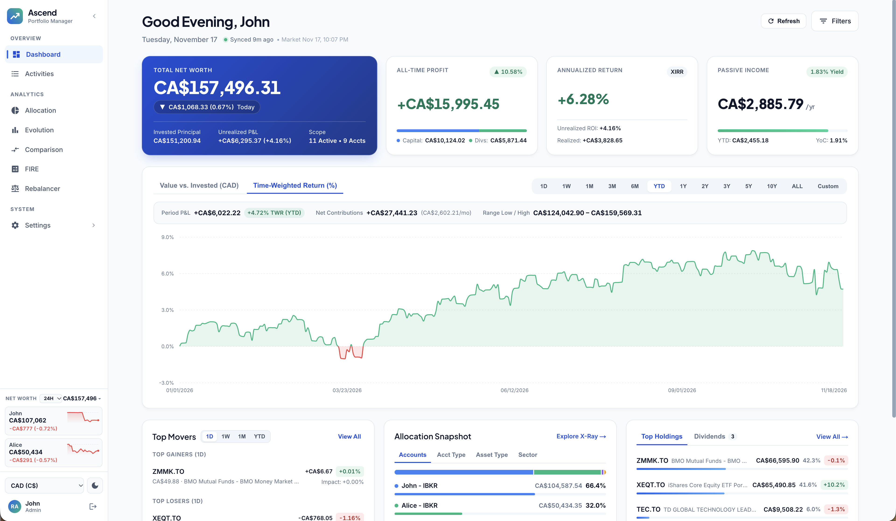
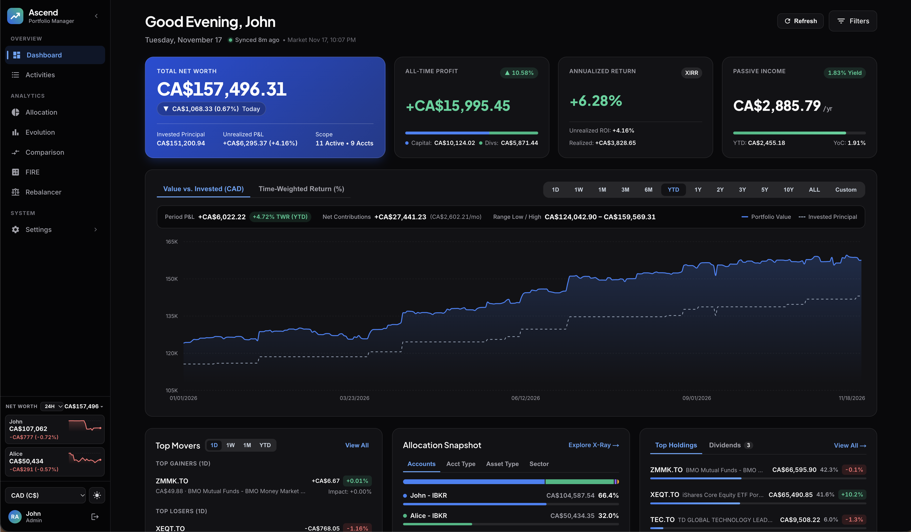

# Ascend — Personal Portfolio Manager [](https://opensource.org/licenses/MIT)

A comprehensive, self-hosted, multi-currency portfolio management platform designed to track, analyze, and rebalance investments across multiple brokerages, currencies, tax accounts, and household owners.

<p align="center">
  
  &nbsp; &nbsp;
  
</p>

## Features

- **Executive Dashboard & Household Owner Snapshots**:
  - **Executive Wealth Strip**: Live Net Worth, All-Time Profit (Capital Gains vs. Dividends split), Annualized XIRR (with `<1Y` guard), and Passive Income (projected annual dividends, yield, YTD progress, and Yield on Cost).
  - **Unified Performance & Valuation Chart**: Time-Weighted Return (TWR) NAV curve and monetary evolution across `1D` through `ALL` and custom date ranges.
  - **Portfolio Pulse Grid**: 1D impact-weighted Top Movers, interactive Allocation Snapshot tabs, and Dividend Summary with upcoming ex-dividend dates.
  - **Sidebar Owner Net Worth Snapshot**: Compact per-owner cards (`24H`, `1W`, `1M`, `YTD`, `1Y`, `ALL`) with interactive sparklines and hover scrubbing.
- **Immutable Ledger & First-Class DRIP Engine**:
  - Track `BUY`, `SELL`, `DIVIDEND`, `DRIP`, `STOCK_SPLIT`, `DEPOSIT`, `WITHDRAWAL`, `TRANSFER_IN`, and `TRANSFER_OUT` activities across platforms and accounts.
  - **DRIP Migration Scanner**: Automatically scans historical `DIVIDEND` + `BUY` pairs and converts eligible reinvestments to `DRIP` without distorting net investor contributions.
  - **Smart CSV Import & Bulk Workflows**: Pre-flight ticker/FX validation with automatic brokerage type alias mapping (e.g., `DIV` → `DIVIDEND`, `Reinvestment` → `DRIP`), batch editing, account transfers, and automated stock-split & dividend scanning.
  - **Ledger Filtering**: Filter by Household Owner, Account Type, Platform, Symbol, Activity Type, and Date Range with live `Net Capital Flow` and `Brokerage Fees` KPIs.
- **Portfolio Rebalancer**:
  - **Full & Buy-Only Modes**: Deploy new cash inflows exclusively into underweight holdings without triggering taxable sales.
  - **Drift Tolerance Bands & Whole-Share Sizing**: Keep turnover disciplined and respect exact cash budgets.
  - **Ticker & Asset-Type Targets**: Rebalance by individual holding or asset category, backed by **Saved Rebalance Profiles** and automated **Glide-Step** lifecycle scheduling.
  - **Tax-Aware Account Routing**: Prioritizes `Tax-Free` and `Tax-Deferred` containers ahead of `Taxable` accounts for sells, surfacing capital-gains warnings.
- **Allocation X-Ray, World Map, Comparison & Asset Deep-Dive**:
  - **Unified 6-Dimension Allocation Explorer (`/analysis/allocation`)**: Switch seamlessly across **Sector**, **Geography** (interactive dark-to-bright **Choropleth World Map**), **Holdings** (portfolio-wide underlying equity X-Ray across direct stocks and full ETF constituent weights), **Asset Type**, **Account Type**, and **Account**.
  - **Unified Holdings & Scope/X-Ray Grid**: Selecting any chart segment, country, or stock embeds a unified Scope Banner (with Direct vs. ETF Look-Through split bar, `Weight`, `Exposure ($)`, and `Share` columns or bucket `Share` %) directly inside the **Holdings** table with zero duplicate rows and a context-aware Return Column selector.
  - **Benchmark Comparison & Wealth Evolution**: Normalized index comparisons (custom benchmarks supported) plus net contribution and dividend growth charts.
  - **Asset Deep-Dive (`/analysis/[symbol]`)**: Cost-basis average price overlay (`avgPriceHistory`), account distribution, side-by-side ETF **Geographic Exposure** and **Underlying Holdings** cards (both `$` and `%`), DRIP reinvestment stats, and per-symbol CSV export.
- **Direct-Issuer ETF Look-Through Engine**:
  - Dedicated adapters for **iShares**, **Vanguard** (with CA-to-US wrapper fallback), **BMO**, and **TD Asset Management** fetch fund sector, country, and full constituent holdings (up to `15,000` positions per fund, keeping dual-class shares separate).
  - Supports external gzip-batched ingestion via `/api/cron/issuer-allocations`, `scripts/push-issuer-allocations.ts`, and `deploy/k8s/issuer-allocations-cronjob.yaml`.
- **FIRE Independence Planner**:
  - Dual mathematical simulation modes (`FIXED_RATE` & `FIXED_HORIZON`), monthly compound inflation, lifestyle sustainability checks, **Saved FIRE Profiles**, and collapsible simulation studio.
- **Modern UI, Obsidian Carbon & Contextual Settings**:
  - Adaptive collapsible sidebar with **Contextual Settings Navigation**, mobile vertical section picker, and **Obsidian Carbon** (`#09090b`) dark theme alongside crisp light mode.
  - Role-Based Access Control (`ADMIN`, `EDITOR`, `VIEWER`) and timing-safe programmatic API access.
- **Coalesced Market Sync & Live UI Convergence**:
  - **Zero Duplicate Yahoo Queries**: Server-side singleflight deduplication and debounced batching (`20` symbols/batch) coalesce simultaneous mobile + laptop refreshes into one upstream lookup while excluding exited positions from 2-minute ticks.
  - **Market-Hours-Aware SWR**: Instant non-blocking reads backed by PostgreSQL `MarketDataCache` (`2m` regular hours / `30m` off-hours quotes, `12h` metadata, `24h` history) plus automatic cross-tab `BroadcastChannel`, visibility/focus revalidation, and convergence polling (with `/api/*` configured `NetworkOnly` in the PWA Service Worker).
  - **Honest Status & RBAC Controls**: Distinguishes local sync freshness (`Synced ...`) from exchange quote timestamps (`Market data ...`), exposes throttler telemetry in **Settings > Master Data**, and gates manual refresh actions to `ADMIN`/`EDITOR` roles.
- **MCP Integration (`ascend-mcp`)**:
  - Connect external AI agents and assistants (Claude Desktop, Antigravity, Cursor) over the Model Context Protocol using `MCP_API_KEY`.

For full feature guides, mathematical formulas, and API docs, explore the **[Ascend Wiki](docs/wiki/Home.md)**.

## Installation

### Option 1: Docker (Recommended - Pre-built Image)

The fastest way to get started using the official pre-built image (supports `amd64` and `arm64`).

**Prerequisites:**
- [Docker](https://docs.docker.com/get-docker/)
- [Docker Compose](https://docs.docker.com/compose/install/)

**Steps:**

1. **Create a directory** for the project and enter it:
   ```bash
   mkdir ascend && cd ascend
   ```

2. **Configure Environment:**
   Create a `.env` file with the following content (or copy from `env.example` if you have the source):
   ```env
   # Database
   POSTGRES_USER=postgres
   POSTGRES_PASSWORD=postgres
   POSTGRES_DB=portfolio_db

   # Next Auth
   NEXTAUTH_URL="http://localhost:3000"
   NEXTAUTH_SECRET="your_secure_random_secret_here" # Generate with: openssl rand -base64 32
   AUTH_TRUST_HOST=true

   # Seeding
   ADMIN_PASSWORD="your_secure_password_here"

   # Optional: Programmatic API / MCP & External Cron Webhooks
   # Built-in in-process scheduler runs automatically; CRON_SECRET is only needed
   # if you trigger /api/cron/* from an external scheduler/webhook.
   # MCP_API_KEY="your_secure_mcp_api_key"
   # CRON_SECRET="your_secure_cron_secret"

   # Optional: Market Data Caching & Sync Tuning
   # MARKET_HOURS_AWARE="true"
   # PRICE_CACHE_TTL_MS=120000
   # OFF_HOURS_PRICE_CACHE_TTL_MS=1800000
   # METADATA_CACHE_TTL_MS=43200000
   # HISTORY_CACHE_TTL_MS=86400000
   # MANUAL_REFRESH_COOLDOWN_MS=15000
   # INCREMENTAL_SYNC_BATCH_SIZE=20
   ```

3. **Create `docker-compose.yml`**:
   Create a file named `docker-compose.yml` with the following content:
   ```yaml
   services:
     app:
       image: rajatpatel7/ascend:latest
       container_name: ascend
       restart: always
       ports:
         - "3000:3000"
       environment:
         - DATABASE_URL=postgresql://${POSTGRES_USER}:${POSTGRES_PASSWORD}@db:5432/${POSTGRES_DB}
         - NEXTAUTH_URL=${NEXTAUTH_URL}
         - NEXTAUTH_SECRET=${NEXTAUTH_SECRET}
         - AUTH_TRUST_HOST=true
         - ADMIN_PASSWORD=${ADMIN_PASSWORD}
         - MCP_API_KEY=${MCP_API_KEY:-}
         - CRON_SECRET=${CRON_SECRET:-}
         - MARKET_HOURS_AWARE=${MARKET_HOURS_AWARE:-true}
         - PRICE_CACHE_TTL_MS=${PRICE_CACHE_TTL_MS:-120000}
         - OFF_HOURS_PRICE_CACHE_TTL_MS=${OFF_HOURS_PRICE_CACHE_TTL_MS:-1800000}
         - METADATA_CACHE_TTL_MS=${METADATA_CACHE_TTL_MS:-43200000}
         - HISTORY_CACHE_TTL_MS=${HISTORY_CACHE_TTL_MS:-86400000}
         - MANUAL_REFRESH_COOLDOWN_MS=${MANUAL_REFRESH_COOLDOWN_MS:-15000}
         - INCREMENTAL_SYNC_BATCH_SIZE=${INCREMENTAL_SYNC_BATCH_SIZE:-20}
       depends_on:
         - db
       networks:
         - portfolio-network

     db:
       image: postgres:15-alpine
       container_name: portfolio-db
       restart: always
       environment:
         - POSTGRES_USER=${POSTGRES_USER}
         - POSTGRES_PASSWORD=${POSTGRES_PASSWORD}
         - POSTGRES_DB=${POSTGRES_DB}
       volumes:
         - postgres_data:/var/lib/postgresql/data
       networks:
         - portfolio-network

   networks:
     portfolio-network:
       driver: bridge

   volumes:
     postgres_data:
   ```

4. **Start the Application:**
   ```bash
   docker-compose up -d
   ```

5. **Access the Dashboard:**
   Open [http://localhost:3000](http://localhost:3000).
   - **Default Admin Credentials**: `admin` / (The password configured in `.env`)

---

### Option 2: Docker (Build from Source)

If you want to modify the code or build the image yourself.

1. **Clone the repository:**
   ```bash
   git clone https://github.com/rajatpatel92/ascend.git
   cd ascend
   ```

2. **Configure Environment:**
   ```bash
   cp env.example .env
   ```
   *Update `.env` with your preferred credentials if needed.*

3. **Run with Docker Compose:**
   ```bash
   docker-compose up -d --build
   ```

---

### Option 3: Local Installation

For development or running without Docker.

**Prerequisites:**
- [Node.js](https://nodejs.org/) (v22+ recommended for native `--experimental-strip-types` test runner)
- [PostgreSQL](https://www.postgresql.org/) database

**Steps:**

1. **Clone and Install Dependencies:**
   ```bash
   git clone https://github.com/rajatpatel92/ascend.git
   cd ascend
   npm install
   ```

2. **Configure Environment:**
   ```bash
   cp env.example .env
   ```
   Update `.env` with your local PostgreSQL credentials.

3. **Setup Database:**
   ```bash
   npx prisma migrate dev
   npx prisma db seed
   ```

4. **Run Tests & Start the Development Server:**
   ```bash
   npm test
   npm run dev
   ```

## Tech Stack

- **Framework**: [Next.js 16](https://nextjs.org/) (App Router) & React 19
- **Database**: PostgreSQL 15+ with [Prisma ORM 5](https://www.prisma.io/)
- **Styling**: CSS Modules with Light & Obsidian Carbon Dark modes
- **Charts**: Chart.js 4 & Recharts 3
- **Market Feeds**: [yahoo-finance2](https://github.com/gadicc/node-yahoo-finance2) with adaptive throttling & circuit breaker
- **Authentication**: [NextAuth.js v5](https://next-auth.js.org/) (`ADMIN`, `EDITOR`, `VIEWER` RBAC)

## Acknowledgments

This project makes use of the following open-source libraries:

- [Next.js](https://nextjs.org/) - The React Framework for the Web
- [React](https://react.dev/) - The library for web and native user interfaces
- [Prisma](https://www.prisma.io/) - Next-generation Node.js and TypeScript ORM
- [NextAuth.js](https://next-auth.js.org/) - Authentication for Next.js
- [Chart.js](https://www.chartjs.org/) - Simple yet flexible JavaScript charting for designers & developers
- [Recharts](https://recharts.org/) - Redefined chart library built with React and D3
- [Framer Motion](https://www.framer.com/motion/) - A production-ready motion library for React
- [Lucide React](https://lucide.dev/) - Beautiful & consistent icon toolkit made by the community
- [date-fns](https://date-fns.org/) - Modern JavaScript date utility library
- [yahoo-finance2](https://github.com/gadicc/node-yahoo-finance2) - Yahoo Finance API wrapper
- [react-icons](https://react-icons.github.io/react-icons/) - Include popular icons in your React projects easily

## License

MIT License

Copyright (c) 2025 rajatpatel92

Permission is hereby granted, free of charge, to any person obtaining a copy
of this software and associated documentation files (the "Software"), to deal
in the Software without restriction, including without limitation the rights
to use, copy, modify, merge, publish, distribute, sublicense, and/or sell
copies of the Software, and to permit persons to whom the Software is
furnished to do so, subject to the following conditions:

The above copyright notice and this permission notice shall be included in all
copies or substantial portions of the Software.

THE SOFTWARE IS PROVIDED "AS IS", WITHOUT WARRANTY OF ANY KIND, EXPRESS OR
IMPLIED, INCLUDING BUT NOT LIMITED TO THE WARRANTIES OF MERCHANTABILITY,
FITNESS FOR A PARTICULAR PURPOSE AND NONINFRINGEMENT. IN NO EVENT SHALL THE
AUTHORS OR COPYRIGHT HOLDERS BE LIABLE FOR ANY CLAIM, DAMAGES OR OTHER
LIABILITY, WHETHER IN AN ACTION OF CONTRACT, TORT OR OTHERWISE, ARISING FROM,
OUT OF OR IN CONNECTION WITH THE SOFTWARE OR THE USE OR OTHER DEALINGS IN THE
SOFTWARE.
