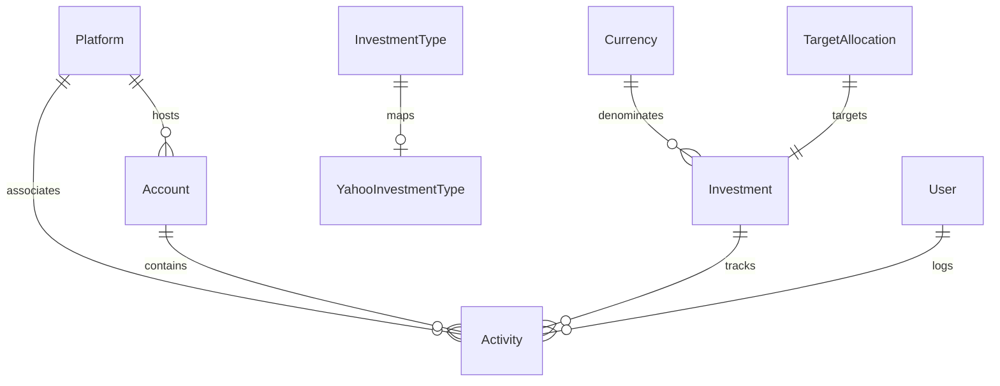

# Architecture & Developer Guide

This document provides a comprehensive technical reference for engineers developing, extending, or self-hosting the **Ascend** platform.

---

## 🏗️ 1. System Architecture & Tech Stack

Ascend is built as a modular, full-stack Next.js application following modern software architecture patterns:

```
┌────────────────────────────────────────────────────────────────────────┐
│                        Next.js 16 (App Router)                         │
│  ┌───────────────────────┐  ┌───────────────────────────────────────┐  │
│  │   React 19 Frontend   │  │           API Route Handlers          │  │
│  │ (CSS Modules, Framer) │  │  (REST Endpoints, NextAuth, RBAC)     │  │
│  └───────────┬───────────┘  └───────────────────┬───────────────────┘  │
│              │                                  │                      │
│              ▼                                  ▼                      │
│  ┌───────────────────────┐  ┌───────────────────────────────────────┐  │
│  │   Client State/Cache  │  │         Domain Core Services          │  │
│  │(ClientCache, Currency)│  │ (PortfolioAnalytics, MarketData, XIRR)│  │
│  └───────────────────────┘  └───────────────────┬───────────────────┘  │
│                                                 │                      │
│                                                 ▼                      │
│                             ┌───────────────────────────────────────┐  │
│                             │       Prisma ORM 5 / PostgreSQL       │  │
│                             └───────────────────────────────────────┘  │
└─────────────────────────────────────────▲──────────────────────────────┘
                                          │ REST API (x-api-key)
                              ┌───────────┴───────────┐
                              │      ascend-mcp       │
                              │ (Model Context Server)│
                              └───────────────────────┘
```

### Core Technologies
* **Framework**: [Next.js 16](https://nextjs.org/) (App Router architecture with React Server Components and Route Handlers).
* **UI & Rendering**: [React 19](https://react.dev/), [Framer Motion 12](https://www.framer.com/motion/) for animations, and CSS Modules for scoped styling.
* **Database & ORM**: PostgreSQL 15+ managed with [Prisma ORM 5](https://www.prisma.io/).
* **Authentication**: [NextAuth.js v5](https://next-auth.js.org/) (Credentials provider, session cookies, bcrypt password hashing).
* **Financial Charting**: [Chart.js 4](https://www.chartjs.org/) with `chartjs-adapter-date-fns`, and [Recharts 3](https://recharts.org/).
* **Market Feeds**: [yahoo-finance2 3.13+](https://github.com/gadicc/node-yahoo-finance2) with adaptive request throttling.
* **External Integration**: Standalone [Model Context Protocol (MCP)](https://modelcontextprotocol.io/) server (`ascend-mcp`).

---

## 🗄️ 2. Database Schema & Data Models (`schema.prisma`)

The database consists of 16 interconnected models defining the portfolio domain:



### Model Definitions

| Model | Primary Key | Key Fields & Purpose |
| :--- | :--- | :--- |
| `Platform` | `id` (UUID) | Brokerage institution (`name`, unique `slug`, default `currency`). |
| `Account` | `id` (UUID) | Tax/currency container (`name`, `type`, `currency`, `platformId`, `isActive`). |
| `Currency` | `code` (String, e.g. "USD") | Currency registry (`rateToBase` multiplier relative to USD). |
| `Investment` | `id` (UUID) | Security record (unique `symbol`, `name`, `type`, `currencyCode`). |
| `Activity` | `id` (UUID) | Immutable ledger entry (`investmentId`, `type`, `date`, `quantity`, `price`, `fee`, `currency`, `platformId`, `accountId`). Indexed on `investmentId`, `accountId`, `date`. |
| `MarketDataCache` | `symbol` (String) | Cached market feeds (`price`, `change`, `changePercent`, `currency`, `history` JSON map, `sectorAllocations` JSON, `countryAllocations` JSON, `dividendRate`, `dividendYield`, `exDividendDate`, `estNextDividendAmount`, `marketTime`, `lastUpdated`). |
| `TargetAllocation` | `id` (UUID) | Rebalancing targets (`symbol`, `targetPercentage`, `yearlyDriftAdjustment`, `lastAdjustmentDate`). |
| `User` | `id` (UUID) | User accounts (unique `username`, salted `password`, `role`: `ADMIN`\|`EDITOR`\|`VIEWER`, `preferredLLM`, `aiEnabled`). |
| `Benchmark` | `id` (UUID) | Comparison indices (unique `symbol`, `name`, `isSystem`). |
| `HiddenDividend` | `id` (UUID) | Excluded dividend declarations (`symbol`, `date`, `amount`). Unique index on `[symbol, date]`. |
| `SystemSetting` | `key` (String) | Encrypted key-value configuration (`value`, `isEncrypted`, `description`). |
| `RateLimit` | `key` (String) | API rate limiting store (`count`, `expiresAt`). |
| `InvestmentType` | `id` (UUID) | Internal asset taxonomy (`name`, `yahooInvestmentTypeId`). |
| `YahooInvestmentType` | `id` (UUID) | Upstream Yahoo security taxonomy (`name`). |
| `ActivityType` | `id` (UUID) | Ledger action definition (`name`, `behavior`: `ADD`\|`REMOVE`\|`NEUTRAL`, `isSystem`). |
| `AccountType` | `id` (UUID) | Container taxonomy (`name`, `currency`). Unique on `[name, currency]`. |

---

## 🧮 3. Financial Calculation & Analytics Engines

### A. Extended Internal Rate of Return (XIRR) — `src/lib/xirr.ts`
Ascend implements the Newton-Raphson numerical method to solve for the root $r$ of the cash-flow polynomial:

$$f(r) = \sum_{i=0}^{N} \frac{C_i}{(1+r)^{\frac{d_i - d_0}{365}}} = 0$$

* **First Derivative ($f'(r)$)**:
  $$f'(r) = \sum_{i=0}^{N} -\left(\frac{d_i - d_0}{365}\right) \cdot \frac{C_i}{(1+r)^{\frac{d_i - d_0}{365} + 1}}$$
* **Iterative Step**: $x_{k+1} = x_k - \frac{f(x_k)}{f'(x_k)}$
* **Convergence Parameters**: Tolerance $\epsilon = 10^{-6}$, maximum iterations $= 100$.
* **Age Guard**: If total holding duration is under 365 days, XIRR returns null to prevent distorted annualized figures.

---

### B. Time-Weighted Return (TWR) Daily NAV Unitization — `src/lib/portfolio-analytics.ts`
Isolates market performance from investor capital inflows/outflows:
1. Initialize day 0 NAV $= 100.00$.
2. On each day $t$:
   * Compute **Passive Market Value**: Total value of day $t-1$ holdings priced at day $t$ closing prices.
   * Net Cash Inflow = $\text{Deposits} + \text{Buys} - \text{Withdrawals} - \text{Sells}$.
   * Update NAV:
     $$NAV_t = NAV_{t-1} \times \left( \frac{\text{Passive Value}_t}{\text{Market Value}_{t-1}} \right)$$
   * Compute units held: $\text{Units}_t = \frac{\text{Market Value}_t}{NAV_t}$.

---

### C. Automated Stock Split Reconciliation — `src/lib/split-detector.ts`
Maintains cost basis integrity when corporate stock splits occur:
1. Queries Yahoo Finance chart events for split events since the first transaction date.
2. **Noise Filter**: Ignores split ratios between $0.90$ and $1.10$ to prevent false-positive phantom splits.
3. **Execution**: Identifies accounts that held the security prior to the split date and creates `STOCK_SPLIT` activities with the exact multiplier ratio.

---

## ⚡ 4. Market Data Engine, Caching & Cron Scheduling

### Adaptive API Throttler (`src/lib/market-data.ts`)
To prevent HTTP 429 ("Too Many Requests") rate limiting when interacting with Yahoo Finance:
* **Concurrency Cap**: Maximum 5 concurrent network requests with 300ms inter-request delays.
* **Circuit Breaker**: If an HTTP 429 response is detected, the throttler triggers an immediate circuit breaker for 60 seconds, rejecting pending calls and notifying the UI to use cached data.

### Multi-Tier Caching Architecture
1. **Client-Side Storage (`ClientCache`)**: Browser `localStorage` caching with TTL expiration for analytical queries (evolution curves, benchmark comparisons, allocation summaries).
2. **In-Memory Currency Cache (`currencyCache.ts`)**: Fast server-side RAM caching of FX exchange rates.
3. **Database Cache (`MarketDataCache`)**: Persistent historical daily price maps and metadata stored in PostgreSQL.

### Background Automation (`src/instrumentation.ts`)
Ascend utilizes the Next.js `register()` hook to start node-cron background schedulers in server runtimes:

```
┌──────────────────┐    Hourly (0 * * * *)      ┌─────────────────────────────────────┐
│                  ├───────────────────────────>│ Full Market Data Refresh (History,   │
│                  │                            │ Dividends, Sector Allocations)      │
│  Node-Cron       ├───────────────────────────>├─────────────────────────────────────┤
│ (instrumentation)│    Every 2 Min (*/2 * * * *)│ Incremental Price Refresh (Prices)  │
│                  ├───────────────────────────>├─────────────────────────────────────┤
│                  │    Daily / On-Demand       │ Glide Path Target Drift Adjustment  │
└──────────────────┘                            └─────────────────────────────────────┘
```

1. **Incremental Price Refresh (`/api/cron/market-data/incremental`)**: Runs every 2 minutes; fetches current market prices and intraday deltas.
2. **Full Market Refresh (`/api/cron/market-data`)**: Runs every hour; fetches complete historical daily prices, ETF sector breakdowns, and declared dividends.
3. **Glide Path Adjuster (`/api/cron/glide-path-adjust`)**: Adjusts rebalancing target allocations based on configured annual drift.

---

## 📡 5. Complete REST API Reference

All routes are located under `src/app/api/` and enforce RBAC via `requireAuth(request, allowedRoles, allowApiKey)`:

| Endpoint | Method | Allowed Roles | Description |
| :--- | :---: | :---: | :--- |
| `/api/portfolio` | `GET` | All | Consolidates Net Worth, Day Change, XIRR, constituents, top movers, dividends. |
| `/api/portfolio/history` | `GET` | All | Returns historical portfolio NAV and valuation points. |
| `/api/holdings` | `GET` | All | Lightweight endpoint returning current quantities and valuations. |
| `/api/activities` | `GET`, `POST` | All (`GET`) / `ADMIN`, `EDITOR` (`POST`) | Paginated ledger fetch and single activity creation. |
| `/api/activities/[id]` | `PUT`, `DELETE` | `ADMIN`, `EDITOR` | Update or delete an activity by ID. |
| `/api/activities/batch-update` | `POST` | `ADMIN`, `EDITOR` | Bulk update account, platform, or date across activities. |
| `/api/activities/batch-delete` | `POST` | `ADMIN`, `EDITOR` | Bulk delete multiple activity IDs. |
| `/api/activities/import/validate` | `POST` | `ADMIN`, `EDITOR` | Pre-flight validation of CSV activity upload. |
| `/api/activities/import/execute` | `POST` | `ADMIN`, `EDITOR` | Atomic batch insertion of validated CSV activities. |
| `/api/accounts/transfer` | `POST` | `ADMIN`, `EDITOR` | Transfer holdings and activities from source to destination account. |
| `/api/rebalancer` | `GET` | All | Calculates current vs target allocations, drift %, and recommended orders. |
| `/api/rebalancer/targets` | `GET`, `POST` | All (`GET`) / `ADMIN`, `EDITOR` (`POST`) | Retrieve or save target allocations and glide-path adjustments. |
| `/api/analysis/[symbol]` | `GET` | All | Asset deep-dive: cost basis history, account distribution, ETF sector weights. |
| `/api/analytics/benchmark` | `POST` | All | Calculates normalized portfolio return vs benchmark index. |
| `/api/analytics/evolution` | `POST` | All | Generates NAV evolution curve, contribution flows, and dividend histories. |
| `/api/dividends/scan` | `GET` | All | Scans market feeds for declared dividends for held assets. |
| `/api/dividends/batch-add` | `POST` | `ADMIN`, `EDITOR` | Batch logs dividends with optional paired DRIP buy activities. |
| `/api/dividends/hide` | `POST` | `ADMIN`, `EDITOR` | Adds dividend to `HiddenDividend` exclusion list. |
| `/api/admin/llm-config` | `GET`, `POST` | `ADMIN` | Read/write third-party LLM API keys and global AI toggle. |
| `/api/ai/analyze` | `POST` | All *(if enabled)* | Submits grounded portfolio queries to Gemini, GPT, or Claude. |
| `/api/cron/market-data` | `GET` | Cron / `ADMIN` | Webhook for full hourly market data refresh. |
| `/api/cron/market-data/incremental` | `GET` | Cron / `ADMIN` | Webhook for 2-minute light price refresh. |
| `/api/cron/glide-path-adjust` | `GET` | Cron / `ADMIN` | Webhook for annual lifecycle glide-path adjustments. |

---

## 🛠️ 6. Development Workflow, Testing & Extension

### Local Setup
```bash
git clone https://github.com/rajatpatel92/ascend.git
cd ascend
npm install

# Setup local postgres and env
cp env.example .env

# Database migrations and seed
npx prisma migrate dev
npx prisma db seed

# Run unit tests
npm test

# Start dev server
npm run dev
```

### Running Tests
Ascend uses Node's native test runner with TypeScript stripping:
```bash
npm test
```
Test files are co-located with implementation using the `*.test.ts` naming convention (e.g., `src/lib/market-data.test.ts`, `src/lib/portfolio-analytics.test.ts`, `src/lib/xirr.test.ts`).

### Guidelines for Future Feature Development
1. **Adding Activity Types**: Register new types in `schema.prisma` and `ActivityType` seed data. Update `computeHoldingsState` in `portfolio-analytics.ts` to define whether the type adds, removes, or preserves units.
2. **Extending Analytics**: Co-locate new financial formulas in `src/lib/` with matching unit tests covering happy path, edge cases, and zero-cash-flow boundaries.
3. **Database Migrations**: Always use `npx prisma migrate dev --name <description>` to ensure database migrations are version-controlled and reproducible.
4. **Security & RBAC**: Wrap all new API endpoints with `requireAuth(request, ['ADMIN', 'EDITOR'])`. Never compare API keys or cron secrets with standard equality operators (`===`); always use `safeCompare()` from `src/lib/api-auth.ts`.
