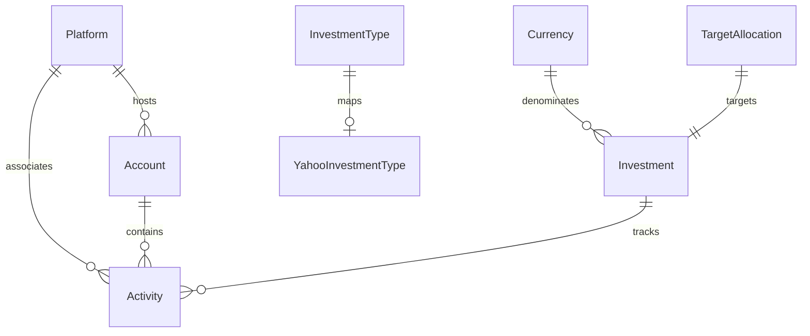

# Architecture & Developer Guide

This document provides a technical reference for engineers developing, extending, or self-hosting the **Ascend** platform.

---

## 🏗️ 1. System Architecture & Tech Stack

Ascend is a full-stack Next.js application using App Router, server route handlers, Prisma ORM, and PostgreSQL:

```
┌────────────────────────────────────────────────────────────────────────┐
│                        Next.js 16 (App Router)                         │
│  ┌───────────────────────┐  ┌───────────────────────────────────────┐  │
│  │   React 19 Frontend   │  │           API Route Handlers          │  │
│  │ (CSS Modules, Framer) │  │  (REST Endpoints, NextAuth, RBAC)     │  │
│  └───────────┬───────────┘  └───────────────────┬───────────────────┘  │
│              │                                  │                      │
│              ▼                                  ▼                      │
│  ┌───────────────────────┐  ┌───────────────────────────────────────┐  │
│  │   Client State/Cache  │  │         Domain Core Services          │  │
│  │(ClientCache, Currency)│  │ (PortfolioAnalytics, MarketData, XIRR)│  │
│  └───────────────────────┘  └───────────────────┬───────────────────┘  │
│                                                 │                      │
│                                                 ▼                      │
│                             ┌───────────────────────────────────────┐  │
│                             │       Prisma ORM 5 / PostgreSQL       │  │
│                             └───────────────────────────────────────┘  │
└─────────────────────────────────────────▲──────────────────────────────┘
                                          │ REST API (x-api-key)
                              ┌───────────┴───────────┐
                              │      ascend-mcp       │
                              │ (Model Context Server)│
                              └───────────────────────┘
```

### Core Technologies
* **Framework**: [Next.js 16](https://nextjs.org/) (App Router with React Server Components & Route Handlers).
* **UI & Rendering**: [React 19](https://react.dev/), [Framer Motion 12](https://www.framer.com/motion/), and CSS Modules (with Obsidian Carbon `#09090b` dark theme).
* **Database & ORM**: PostgreSQL 15+ managed with [Prisma ORM 5](https://www.prisma.io/).
* **Authentication**: [NextAuth.js v5](https://next-auth.js.org/) (Credentials provider, session cookies, `bcryptjs` hashing).
* **Financial Charting**: [Chart.js 4](https://www.chartjs.org/) (`chartjs-adapter-date-fns`) and [Recharts 3](https://recharts.org/).
* **Market Feeds**: [yahoo-finance2](https://github.com/gadicc/node-yahoo-finance2) with adaptive request throttling and 429 circuit breaking.
* **External Agents**: Standalone Model Context Protocol server (`ascend-mcp`).

---

## 🗄️ 2. Database Schema & Data Models (`prisma/schema.prisma`)



### Model Definitions

| Model | Primary Key | Key Fields & Purpose |
| :--- | :--- | :--- |
| `Platform` | `id` (UUID) | Brokerage institution (`name`, unique `slug`, default `currency`). |
| `Account` | `id` (UUID) | Tax/currency container (`name`, `type`, `currency`, `platformId`, `isActive`). |
| `Currency` | `code` (String) | Currency registry (`rateToBase` multiplier relative to USD). |
| `Investment` | `id` (UUID) | Security record (unique `symbol`, `name`, `type`, `currencyCode`). |
| `Activity` | `id` (UUID) | Immutable ledger entry (`investmentId`, `type` including `DRIP`, `date`, `quantity`, `price`, `fee`, `currency`, `platformId`, `accountId`). Indexed on `investmentId`, `accountId`, `date`. |
| `MarketDataCache` | `symbol` (String) | Cached market feeds (`price`, `change`, `changePercent`, `currency`, `history` JSON, `sectorAllocations` JSON, `countryAllocations` JSON, dividend metadata, `marketTime`, `lastUpdated`). |
| `TargetAllocation` | `id` (UUID) | Rebalancing targets (`symbol`, `targetPercentage`, `yearlyDriftAdjustment`, `lastAdjustmentDate`). |
| `User` | `id` (UUID) | User accounts (unique `username`, `name`, salted `password`, `role`: `ADMIN` \| `EDITOR` \| `VIEWER`). |
| `Benchmark` | `id` (UUID) | Comparison indices (unique `symbol`, `name`, `isSystem`). |
| `HiddenDividend` | `id` (UUID) | Excluded dividend declarations (`symbol`, `date`, `amount`). Unique on `[symbol, date]`. |
| `RateLimit` | `key` (String) | API rate limiting counters (`count`, `expiresAt`). |
| `SystemSetting` | `key` (String) | JSON/string system persistence (`fire_profiles_v1`, `rebalancer_profiles_v1`, etc.). |
| `InvestmentType` | `id` (UUID) | Internal asset taxonomy (`name`, `yahooInvestmentTypeId`). |
| `YahooInvestmentType` | `id` (UUID) | Upstream Yahoo security taxonomy (`name`). |
| `ActivityType` | `id` (UUID) | Ledger action definition (`name`, `behavior`: `ADD` \| `REMOVE` \| `NEUTRAL` \| `SPLIT`, `isSystem`). |
| `AccountType` | `id` (UUID) | Container taxonomy (`name`, `currency`). Unique on `[name, currency]`. |

---

## 🧮 3. Financial Calculation & Domain Engines

### A. XIRR (`src/lib/xirr.ts`)
Solves for the annualized discount rate $r$ via Newton-Raphson iteration ($\epsilon = 10^{-6}$, max 100 iterations) with a `<1Y` (< 365 days) null guard so short holding windows never show exaggerated annualized extrapolations.

### B. TWR Unitization & DRIP-Aware Cash Flows (`src/lib/portfolio-analytics.ts`, `src/lib/performance-chart.ts`)
Tracks daily unitized NAV ($NAV_0 = 100$) isolating asset strategy returns from deposits/withdrawals. First-class `DRIP` activities add reinvested share lots without inflating out-of-pocket net investor capital contributions.

### C. DRIP Migration & CSV Alias Helpers (`src/lib/drip-migration.ts`, `src/lib/activity-helpers.ts`)
* `scanDripMigrationCandidates`: Pairs historical `DIVIDEND` and `BUY` activities within `[-1, +5]` days across matching `(symbol, accountId)` with `BATCH_PAIR`, `EXACT_COST`, `ROUNDED_DRIP`, `WHOLE_SHARE`, and `NET_OF_TAX` confidence heuristics.
* `normalizeActivityType`: Normalizes brokerage CSV type aliases (`REINVEST`, `DIVIDEND REINVESTMENT`, `DIV`, `STOCK SPLIT`, `TRANSFER IN`, etc.) to canonical Ascend types.

### D. Rebalancer Planner & Tax Extensions (`src/lib/rebalance-planner.ts`, `src/lib/rebalance-extensions.ts`)
* `computeRebalancePlan`: Supports `FULL` and `BUY_ONLY` cash-inflow allocation, drift tolerance bands (`tolerancePercent`), and whole-share order sizing.
* `allocateTradeAcrossAccounts` & `classifyAccountTaxStatus`: Prioritizes `TAX_FREE` and `TAX_DEFERRED` accounts ahead of `TAXABLE` accounts on sells.
* `computeCategoryRebalancePlan` & `simulateGlideStep`: Supports Asset-Type target rebalancing and `+1Y` glide-path simulation.

### E. Owner Net Worth Snapshot (`src/lib/owner-snapshot.ts`)
Groups portfolio history and intraday valuation points by account owner (`1D` / `24H`, `1W`, `1M`, `YTD`, `1Y`, `ALL`) for the sidebar `SidebarOwnerSnapshot` sparkline cards.

### F. Look-Through Portfolio X-Ray (`src/lib/look-through.ts`)
Decomposes ETF `sectorAllocations` and `countryAllocations`, normalizing GICS categories, attributing residual cash reserves, and powering instant cross-filtering across `ConstituentsGrid`.

### G. FIRE Profiles (`src/lib/fire-profiles.ts`) & Settings Navigation (`src/lib/settings-nav.ts`)
* `fire-profiles.ts`: Sanitizes and manages multi-scenario FIRE retirement profiles persisted in `SystemSetting`.
* `settings-nav.ts`: Provides role-aware Settings sections and active-route matching for `Sidebar.tsx` and `/settings/layout.tsx`.

### H. Automated Stock Split Reconciliation (`src/lib/split-detector.ts`)
Detects corporate stock splits from Yahoo Finance chart events while ignoring `[0.90, 1.10]` phantom ratio noise and future dates.

---

## ⚡ 4. Market Data Engine, Caching & Cron Scheduling

* **Adaptive Throttler (`src/lib/market-data.ts`)**: Caps concurrent Yahoo Finance fetches (max 5 concurrent, 300ms spacing) with an automatic 60-second circuit breaker on HTTP `429`.
* **Multi-Tier Cache**: Client `localStorage` TTL cache (`ClientCache`), in-memory FX cache (`currencyCache.ts`), and PostgreSQL `MarketDataCache`.
* **Background Scheduler (`src/instrumentation.ts`)**:
  * **Every 2 minutes** (`*/2 * * * *`): `/api/cron/market-data/incremental`
  * **Every hour** (`0 * * * *`): `/api/cron/market-data`
  * **Daily / On-Demand**: `/api/cron/glide-path-adjust`

---

## 📡 5. Complete REST API Reference

All routes live under `src/app/api/` and enforce RBAC via `requireAuth(request, allowedRoles, allowApiKey)`:

| Endpoint | Methods | Allowed Roles | Description |
| :--- | :---: | :---: | :--- |
| `/api/portfolio` | `GET` | All | Consolidates Net Worth, Day Change, XIRR, constituents, movers, look-through breakdowns, dividends. |
| `/api/portfolio/history` | `GET` | All | Historical portfolio NAV and valuation series. |
| `/api/portfolio/owner-snapshot` | `GET` | All | Per-owner net worth, change %, and sparkline series for `1D`/`1W`/`1M`/`YTD`/`1Y`/`ALL`. |
| `/api/holdings` | `GET` | All | Current share quantities and market valuations. |
| `/api/activities` | `GET`, `POST` | All (`GET`) / `ADMIN`, `EDITOR` (`POST`) | Filtered/paginated activity ledger and transaction creation. |
| `/api/activities/[id]` | `PUT`, `DELETE` | `ADMIN`, `EDITOR` | Update or delete an individual activity. |
| `/api/activities/batch-update` | `POST` | `ADMIN`, `EDITOR` | Bulk update account, platform, date, or type. |
| `/api/activities/batch-delete` | `POST` | `ADMIN`, `EDITOR` | Bulk delete selected activity IDs. |
| `/api/activities/import/validate` | `POST` | `ADMIN`, `EDITOR` | Pre-flight CSV validation with brokerage alias normalization. |
| `/api/activities/import/execute` | `POST` | `ADMIN`, `EDITOR` | Atomic batch creation of validated CSV rows. |
| `/api/activities/migrate-drip` | `GET`, `POST` | `ADMIN`, `EDITOR` | Scan and migrate historical `DIVIDEND` + `BUY` pairs into `DRIP`. |
| `/api/accounts`, `/api/accounts/[id]` | `GET`, `POST`, `PUT`, `DELETE` | All (`GET`) / `ADMIN`, `EDITOR` | Manage investment accounts and active/inactive state. |
| `/api/accounts/transfer` | `POST` | `ADMIN`, `EDITOR` | Atomically transfer activities between accounts. |
| `/api/platforms`, `/api/platforms/[id]` | `GET`, `POST`, `PUT`, `DELETE` | All (`GET`) / `ADMIN`, `EDITOR` | Manage brokerage platforms. |
| `/api/rebalancer` | `GET` | All | Compute target vs. actual allocations, drift, and tax-aware order guidance. |
| `/api/rebalancer/targets` | `GET`, `POST` | All (`GET`) / `ADMIN`, `EDITOR` | Read or update `TargetAllocation` records. |
| `/api/rebalancer/profiles` | `GET`, `POST`, `DELETE` | All (`GET`) / `ADMIN`, `EDITOR` | Manage saved rebalance profiles (`rebalancer_profiles_v1`). |
| `/api/fire/profiles` | `GET`, `POST`, `DELETE` | All (`GET`) / `ADMIN`, `EDITOR` | Manage saved FIRE simulation profiles (`fire_profiles_v1`). |
| `/api/analysis/[symbol]` | `GET` | All | Asset deep-dive: `avgPriceHistory`, account breakdown, ETF allocations, DRIP & ledger stats. |
| `/api/analytics/benchmark` | `POST` | All | Normalized portfolio TWR vs. benchmark index return & alpha. |
| `/api/analytics/evolution` | `POST` | All | Historical NAV curve, net contributions (DRIP-excluded), and dividend growth. |
| `/api/dividends/scan` | `POST` | `ADMIN`, `EDITOR` | Scan market dividends & chart events for held symbols. |
| `/api/dividends/batch-add` | `POST` | `ADMIN`, `EDITOR` | Batch insert `DIVIDEND` and optional paired `DRIP` entries. |
| `/api/dividends/hide` | `POST`, `DELETE` | `ADMIN`, `EDITOR` | Manage `HiddenDividend` exclusion records. |
| `/api/benchmarks`, `/api/benchmarks/[id]` | `GET`, `POST`, `DELETE` | All (`GET`) / `ADMIN`, `EDITOR` | Manage custom comparison benchmarks. |
| `/api/users`, `/api/users/[id]` | `GET`, `POST`, `PUT`, `DELETE` | `ADMIN` *(list/write)* | User provisioning, roles, and password updates. |
| `/api/settings/*` | `GET`, `POST`, `PUT`, `DELETE` | All (`GET`) / `ADMIN` | Master taxonomy (`account-types`, `activity-types`, `investment-types`, `yahoo-types`). |
| `/api/cron/market-data` | `GET` | Cron / `ADMIN` | Full hourly market data & metadata sync webhook. |
| `/api/cron/market-data/incremental` | `GET` | Cron / `ADMIN` | 2-minute incremental price refresh webhook. |
| `/api/cron/glide-path-adjust` | `GET`, `POST` | Cron / `ADMIN` | Annual lifecycle glide-path target adjustment webhook. |

---

## 🛠️ 6. Development Workflow, Testing & Extension

### Local Setup
```bash
git clone https://github.com/rajatpatel92/ascend.git
cd ascend
npm install

cp env.example .env
npx prisma migrate dev
npx prisma db seed

npm test
npm run dev
```

### Running Tests
Ascend runs `267` unit and integration tests using Node's native test runner with `--experimental-strip-types`:
```bash
npm test
```
Tests are co-located using `*.test.ts` (e.g., `src/lib/drip-migration.test.ts`, `src/lib/owner-snapshot.test.ts`, `src/lib/rebalance-planner.test.ts`, `src/lib/settings-nav.test.ts`).

### Extension Guidelines
1. **New Activity Types**: Register in `ActivityType` seed data and `buildBehaviorMap` (`src/lib/activity-helpers.ts`) so `computeHoldingsState` handles `ADD`/`REMOVE`/`NEUTRAL`/`SPLIT` accurately.
2. **Financial Math**: Co-locate pure helpers in `src/lib/` with `.test.ts` coverage across happy paths, boundary conditions, and empty/zero-flow edge cases.
3. **Auth & Secrets**: Guard every new API route with `requireAuth(...)` and compare programmatic secrets exclusively via `safeCompare()`.
